# HireDesk — Applicant Tracking & Onboarding

Recruiting and onboarding system built with **Laravel 13** and **Filament 5**: post jobs, screen applicants automatically, move candidates through custom pipeline stages, schedule interviews, send offers for e-signature and onboard new hires through a paperless portal.

**[Live demo](https://hiredesk-ats.onrender.com)** · [Admin](https://hiredesk-ats.onrender.com/admin) (click **Sign in**, login is pre-filled) · [Careers site](https://hiredesk-ats.onrender.com/careers)

Runs on Render's free plan, so the first visit after a quiet period can take about a minute to wake up. Sample data resets on every deploy.

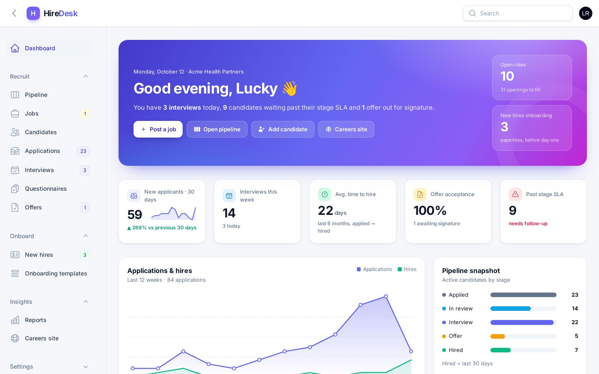

## Features

**Recruit**
- **Custom pipeline stages** — a workflow per job type; each stage has a colour, reporting category, SLA and automations that run when a candidate enters (email, text, questionnaire, scorecard request, auto-reject, talent pool, offer draft, background check, onboarding)
- **Kanban pipeline** — drag candidates between stages (or use "Move to…" on touch screens); SLA warnings and screening scores on every card
- **Jobs & requisitions** — draft → approval → published, departments, locations, pay ranges, hiring team
- **Branded careers site** — keyword + ZIP-code radius search, filters, mobile apply form, social share links, JSON-LD for Google Jobs, XML feed for Indeed / ZipRecruiter (`/jobs.xml`)
- **Screening questionnaires** — knock-out questions, weighted points and resume keyword scoring (0–100)
- **Resume parsing** — TXT, DOCX and PDF text extraction; skills, years of experience and phone detected
- **Candidate database** — profiles, Boolean keyword search (`ICU AND (ACLS OR BLS) NOT travel`), radius search, talent pool, duplicate detection by email
- **Candidate profile** — stage bar, screening breakdown, resume, scorecards, email/SMS thread, interviews, private notes, activity timeline, star rating
- **Interviews** — scheduling with interviewers, `.ics` calendar invites, status tracking
- **Scorecards** — 1–5 rating and hire recommendation per interviewer
- **Email & SMS** — branded templates with merge fields; SMS logged in demo mode (Twilio-ready)
- **Offers** — draft → approval → e-signature (drawn signature on any device) → signed, printable letter

**Onboard**
- **One-click hire** — creates the employee, checklist and a secure new-hire portal link
- **Onboarding templates** — forms, e-sign documents, uploads, training and HR / IT / manager tasks with due dates relative to the start date
- **New-hire portal** — mobile-friendly; complete forms, sign policies, upload licences, see first-day details

**Insights**
- **Dashboard** — KPIs, applications & hires trend, pipeline snapshot, upcoming interviews, SLA alerts, activity feed, open jobs, sources, onboarding progress
- **Reports** — hiring funnel, monthly trend, source effectiveness, time to hire by department, EEO / voluntary self-ID summary, interviewer activity, CSV export
- **Team & roles** — admin, recruiter, hiring manager

## Screenshots

| Hiring pipeline (Kanban) | Pipeline stages & automations |
| --- | --- |
| 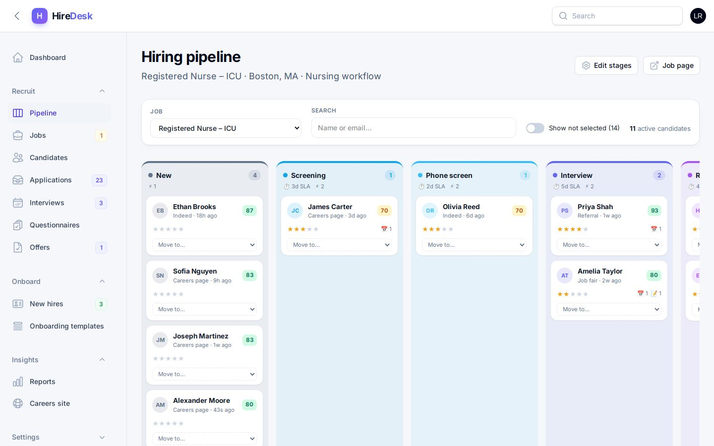 | 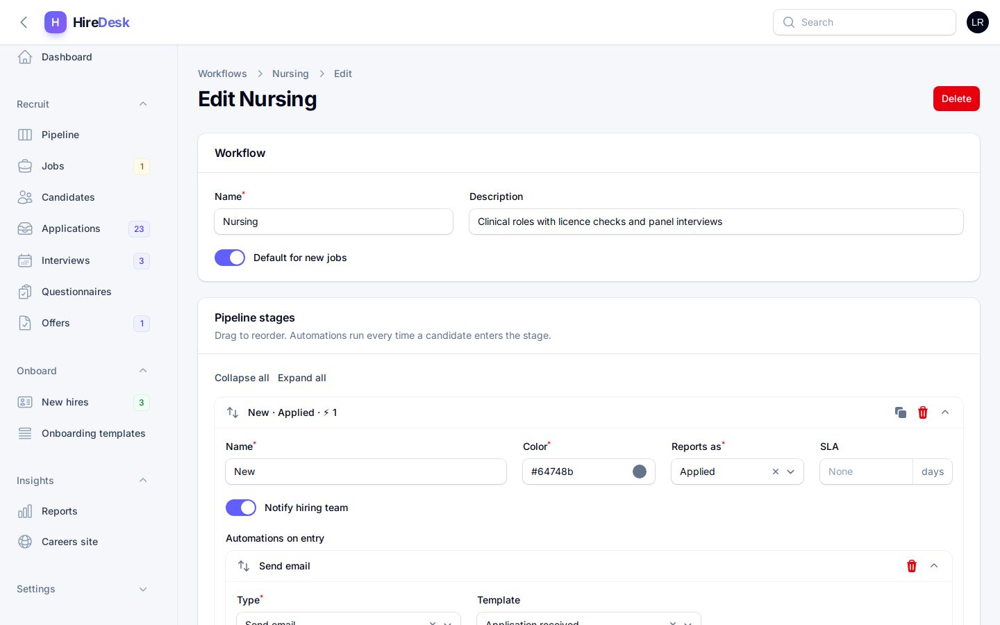 |

| Candidate profile | Reports |
| --- | --- |
| 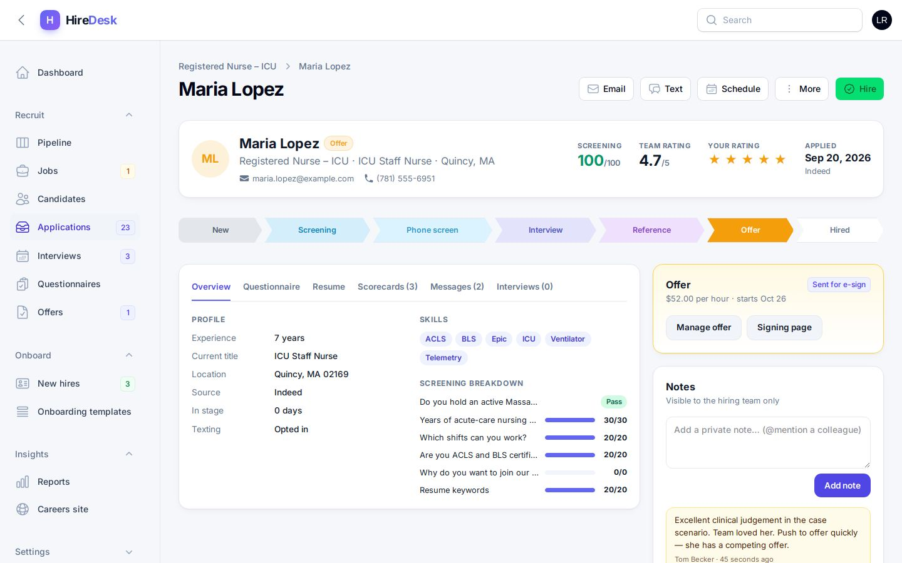 | 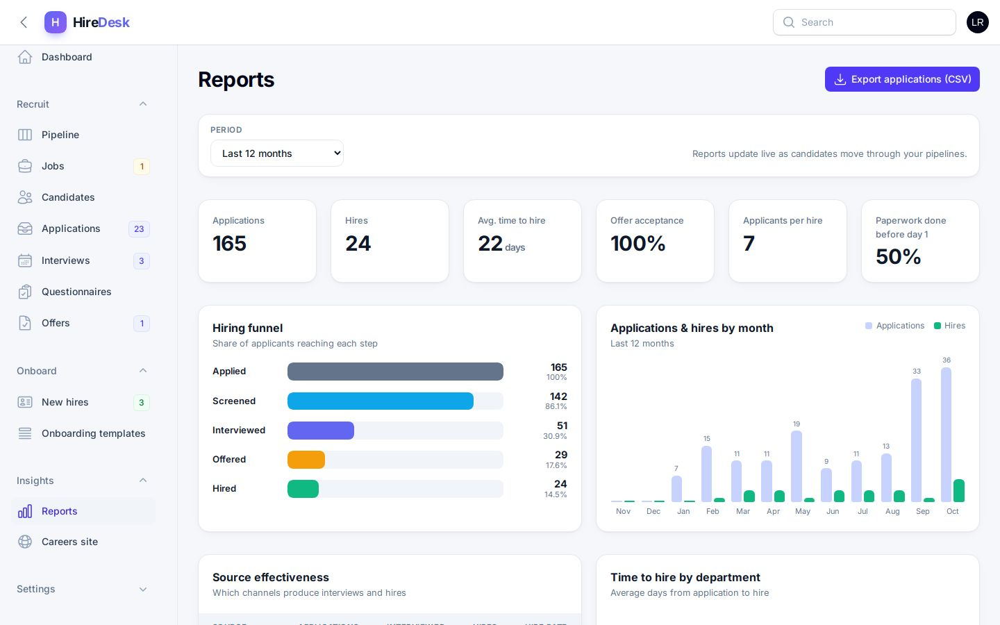 |

| Careers site | Apply with screening questions |
| --- | --- |
| 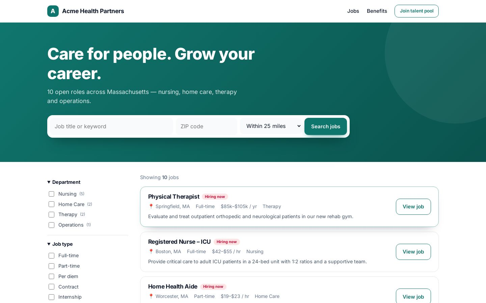 | 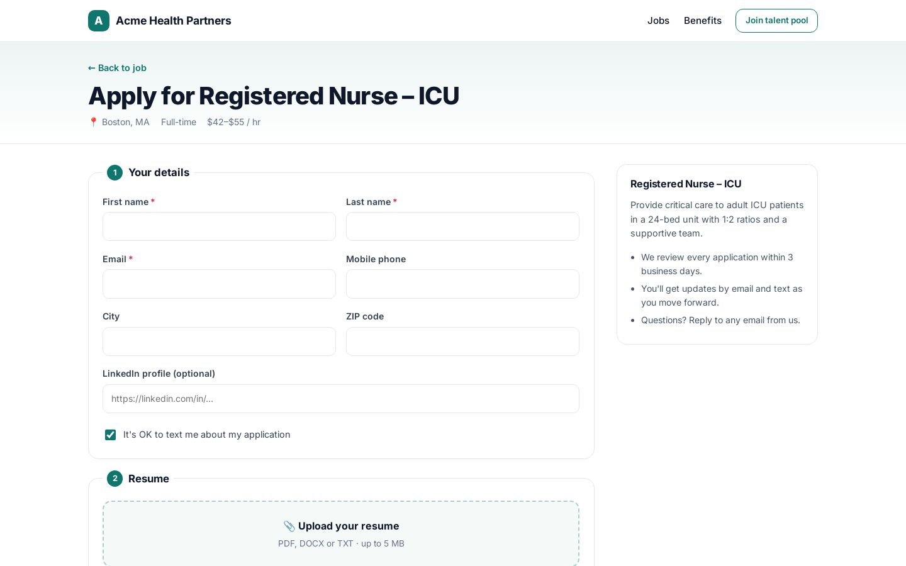 |

| Offer e-signature | New-hire portal |
| --- | --- |
| 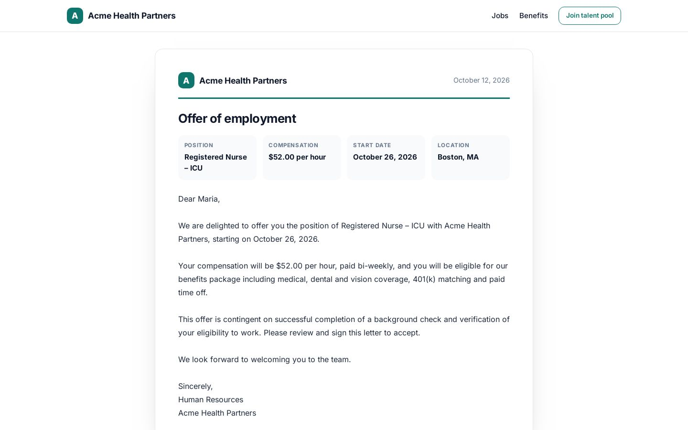 | 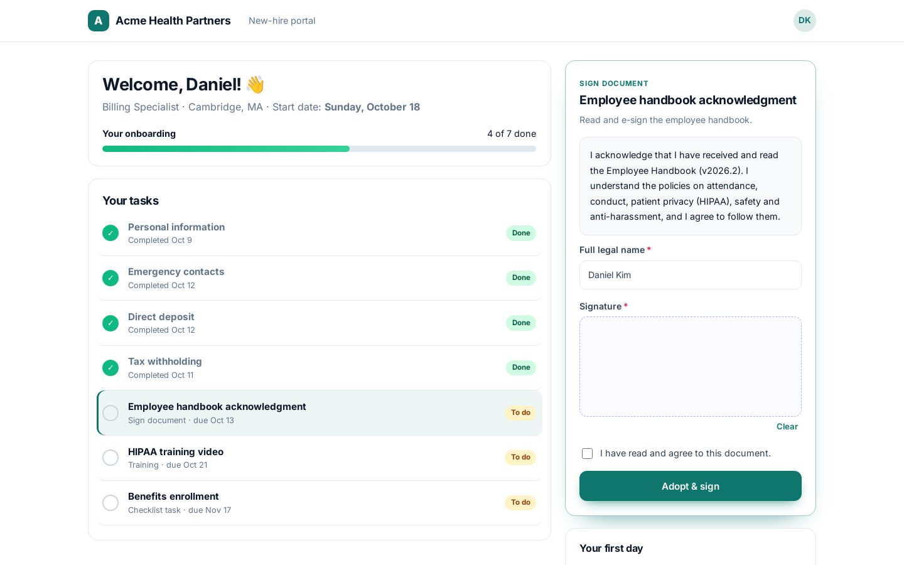 |

| Mobile dashboard | Mobile careers | Mobile new-hire portal |
| --- | --- | --- |
| 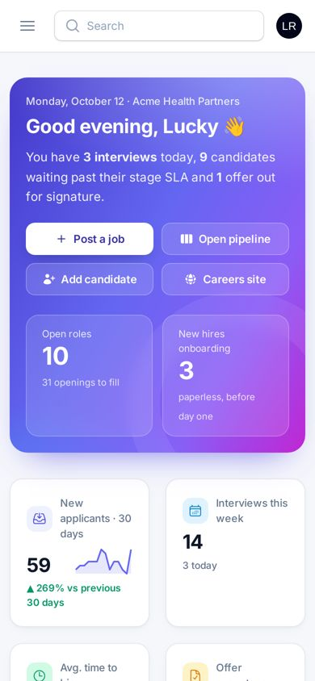 | 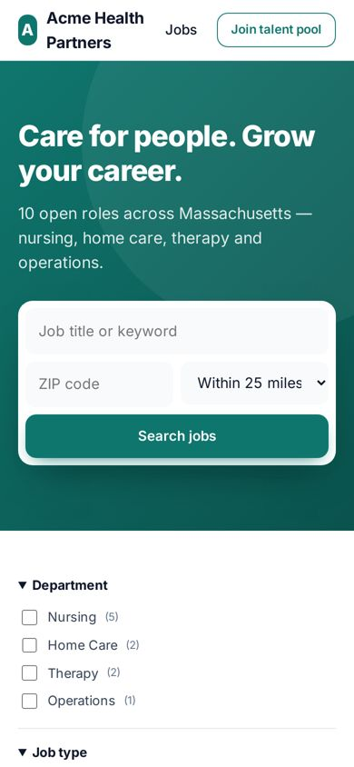 | 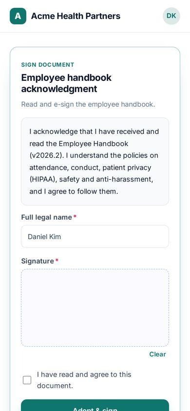 |

## Tech stack

PHP 8.3+ · Laravel 13 · Filament 5 · Livewire · Alpine.js · SQLite / MySQL / PostgreSQL · PHPUnit · Docker

## Setup

```bash
git clone https://github.com/contact-luckyram/hiredesk-ats.git
cd hiredesk-ats
composer run setup
php artisan serve
```

Open `http://127.0.0.1:8000` and sign in at `/admin` with `admin@hiredesk.test` / `password`.
Other demo users: `rachel@hiredesk.test` (recruiter), `tom@hiredesk.test` (hiring manager) — all with password `password`.

Run the tests with `php artisan test`. `php artisan hiredesk:demo-urls` prints links to the careers site, an offer signing page and a new-hire portal.

## Deploy (free)

The repo includes a `Dockerfile` and a Render Blueprint (`render.yaml`):
render.com → **New → Blueprint** → pick this repo. The container seeds fresh demo data on every boot.

Settings: `HIREDESK_COMPANY`, `HIREDESK_TAGLINE`, `HIREDESK_BRAND` (hex colour), `MAIL_*` for real email.

## Project structure

```text
app/
├── Filament/
│   ├── Pages/        Dashboard, Pipeline (Kanban), Reports
│   └── Resources/    Jobs, Candidates, Applications, Interviews, Offers, Questionnaires,
│                     Employees, Onboarding templates, Workflows & stages, Templates, Team
├── Http/Controllers/ Careers site, offer e-sign, new-hire portal, files & exports
├── Models/           JobOpening, Workflow, Stage, Candidate, Application, Interview, Offer, Employee…
└── Services/         PipelineService (stage moves + automations), ApplicationIntake, ScreeningService,
                      ResumeParser, OnboardingService, Messenger
database/seeders/     Demo company: team, workflows, 12 jobs, ~170 candidates, interviews, offers, new hires
```

## Contact

Built by **Lucky Ram** — Laravel & Filament developer, open to freelance projects.
contact.luckyram@gmail.com
